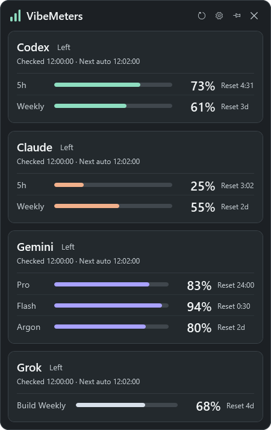
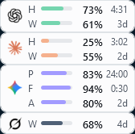
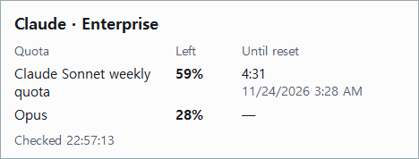

# VibeMeters

[한국어](README.md) · **English**

Track your remaining Codex, Claude, Gemini and Grok quotas and see when each limit resets. VibeMeters runs on Windows 10 and 11 (x64) and offers a resizable dashboard and optional taskbar widgets.

[Download the Windows x64 ZIP](https://github.com/Nectarine-Peach/VibeMeters/releases/latest/download/VibeMeters-win-x64.zip) · [v1.4.15 release notes](docs/releases/v1.4.15.md)



## Install or update

1. Download and extract the entire ZIP to a folder you want to keep. Leave the `runtime` folder beside `VibeMeters.exe`. The package includes .NET and the Gemini runtime.
2. Run `VibeMeters.exe` and open **Settings** using the gear. Under **General → Services · Display basis**, choose the services you want to see and whether each shows the percentage **remaining** or **used**.
3. Open **Accounts · CLI** in Settings to connect a service. If an official CLI sign-in already exists, refresh the dashboard to check it. Press **F5** to refresh manually.

Under **Settings → Accounts · CLI → CLI installation and updates**, check the installed versions of Codex CLI, Claude Code and Antigravity CLI. Click **Install** or **Update** once to start; the same button becomes **Cancel** while running. Maintenance is separate from sign-in. Installation policy or unsupported installation methods are reported in the service row. [CLI management](docs/cli-installation.md)

When updating, exit VibeMeters from the tray menu before extracting the new ZIP into a new folder. The app reuses your settings and CLI sign-ins. If the executable moved and you use **Start with Windows**, turn that setting off and back on to register its new location.

## Taskbar widgets

In **Settings → General → Services · Display basis**, each service has a widget toggle independent of its dashboard checkbox. Windows displays the selected widgets in free space inside the primary taskbar. Click a widget to open the dashboard.

Widgets use the gap immediately before the notification area, on the right for a horizontal taskbar or toward the notification end for a vertical taskbar. They stay on that side of the Start/apps cluster. When space is limited, some widgets hide while the others retain readable widths. Full-screen applications and taskbar auto-hide remain respected.



Each row shows a quota label, graph, percentage and reset countdown. `H` means five hours and `W` means weekly; `M` labels individual-budget or monthly-extra-usage rows. Gemini uses `P` for Pro, `F` for Flash, `FL` for Flash-Lite and `A` for Argon. The dashboard uses longer names. A countdown of `4:31` means four hours and 31 minutes. Times up to 24 hours use hours and minutes, and longer intervals show whole days. Countdowns continue in manual refresh mode.

**Hover over a widget** to see full quota names and the local reset date and time when available. The tooltip opens toward the desktop, keeping neighboring widgets visible. In this example, Claude Sonnet has 59% remaining and resets in 4 hours and 31 minutes. Opus has 28% remaining, and the service supplied no reset time.



## Connect your accounts

| Service | How to connect | Quotas you can see |
| --- | --- | --- |
| Codex | Use **Sign in to Codex** or an existing official CLI session. | Reported subscription windows and the individual limit for Business accounts. |
| Claude | Use **Sign in to Claude** or an existing Claude Code session. Automatic renewal requires Claude Code 2.1.317 or later. | Personal five-hour and weekly limits, plus enabled monthly additional usage for personal and Enterprise accounts. |
| Gemini | Use the signed-in Antigravity CLI (1.4.7 or newer) for personal accounts, or connect a Code Assist account with project access. | Shared Gemini and Argon quotas reported by Antigravity, or model-specific Code Assist quotas. Gemini web and app limits are separate. |
| Grok | Install the official Grok Build CLI and choose **Sign in to Grok**, or run `grok login --oauth`. | Build-only and shared subscription quotas reported by the CLI. |

**Multiple Gemini accounts.** Under **Settings → Accounts · CLI → Gemini account**, select **Default CLI account** to use your existing connection, or **Antigravity** for the personal account signed in there. **Code Assist 1** and **Code Assist 2** store independent company sessions. Select a slot, use **Sign in to Gemini**, then repeat for the second slot. Switch slots to choose which account to display.

Codex and Claude sign-in buttons launch the official CLI and open browser authentication. If a required CLI is missing, Settings offers its official user-scoped installer. A website or desktop sign-in alone may leave the CLI disconnected. Gemini personal sign-in opens Antigravity; refresh after switching accounts there. Each service controls which quotas it reports. [Account and quota details](docs/account-usage.md) · [CLI installation](docs/cli-installation.md) · [Grok guide](docs/grok-usage.md)

## Everyday controls

| Action | How |
| --- | --- |
| Refresh usage | Click the refresh icon, press **F5** or use the tray menu. |
| Pin the dashboard | Click the pin icon or choose the tray menu option. |
| Hide or reopen | Close the window or press **Esc** to hide it. Click the tray icon or a widget to reopen it. |
| Quit | Right-click the tray icon and choose **Exit**. |
| Change appearance or alerts | Open **Settings → General** for light, dark or system theme, Korean or English, and optional alerts at 20% and 5% remaining. |

Window size, placement and preferences save automatically. Automatic refresh defaults to two minutes. Choose 30 seconds, 1, 2, 5 or 15 minutes, or manual. Polling pauses while Windows is locked or asleep. A provider's retry deadline may delay the next check.

## Troubleshooting

| What you see | What to check |
| --- | --- |
| Codex or Claude needs a connection | Complete official CLI sign-in and refresh. Credential changes also trigger a check. If Claude reports an outdated CLI, [update Claude Code](https://code.claude.com/docs/en/setup#update-claude-code). |
| A retry time or a **Previous** Claude reading | Hover for status and retry details. Claude honors usage-lookup rate limits across restarts. During a temporary error, a prior reading is eligible for up to 30 minutes while the credential is the same and the window has yet to reset. |
| A connected account has no percentage or reset time | VibeMeters displays the information the service supplies. Check the selected account, project access, SSO and corporate network restrictions. |
| A selected widget is missing | Check that the service's widget toggle is on and that the primary taskbar has enough free space. |
| Startup stopped after moving the app | Toggle **Start with Windows** off and on in Settings. |

**Observed** is the last successful quota reading. **Checked** is the latest completed check, including an error. **Next automatic** is the next eligible scheduled check. Manual refresh honors server retry times. For a bug report, include the version, Windows display scaling, window size, service and visible error. Omit access tokens and credential files. [Report a bug](https://github.com/Nectarine-Peach/VibeMeters/issues)

## Privacy and technical references

Preferences are stored in `%LOCALAPPDATA%\VibeMeters\settings.json`. The installed official clients manage authentication. VibeMeters can read existing Codex and Claude credentials and invoke their official CLI recovery paths. Gemini and Grok quota polling requests usage information without sending model prompts. Claude renewal diagnostics contain reason codes and state changes. The app is an independent project. [Account integration details](docs/account-usage.md) · [Implementation research](RESEARCH.md) · [Verification scope](VERIFICATION.md)

<details>
<summary>Build and verify on Windows</summary>

Install the .NET 8 SDK and Node.js 24.22.0 with npm. From a checkout, run:

```powershell
dotnet build -c Release
dotnet run --project tests/VibeMeters.Tests.csproj -c Release
dotnet .\bin\Release\net8.0-windows\VibeMeters.dll --smoke-test
.\scripts\publish.ps1
```

The smoke test uses synthetic accounts and writes results and PNGs to the build folder's `artifacts` directory. Run `VibeMeters.exe --demo` for an interactive preview. Publishing produces `dist/VibeMeters-portable-win-x64/` and its ZIP. A successful publish prunes older generated packages in `dist`. Choose a new output directory outside `dist` to keep a separate build. [Packaging guide](docs/packaging.md) · [Screenshot gallery](docs/screenshots/README.md)

</details>
