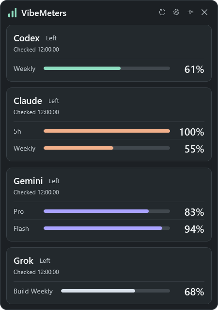
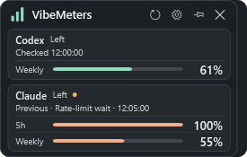
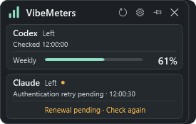
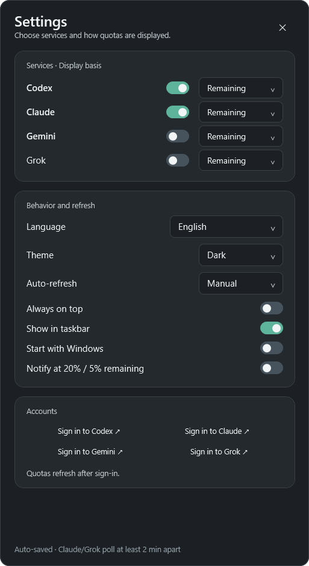

# VibeMeters

[한국어](README.md) · **English**

Keep your **Codex, Claude, Gemini, and Grok quotas** visible in a small Windows tray window.

**Windows 10/11 x64 · Always on top · Dark / light / system theme**

**English and Korean UI:** Settings → Language switches between System, 한국어 and English immediately and saves your choice.

**Personal Gemini via Antigravity and Grok Build subscription quotas are displayed inside the app.**

[Download ZIP for Windows](https://github.com/Nectarine-Peach/VibeMeters/releases/latest/download/VibeMeters-win-x64.zip) · [Release notes](https://github.com/Nectarine-Peach/VibeMeters/releases/latest)

v1.4.11 improves Claude and Codex sign-in recovery, honors Gemini's server retry deadlines, and handles Grok credential changes during a lookup. [What's new in v1.4.11](docs/releases/v1.4.11.md)



*The v1.4.11 WPF window with example quotas for all four services.*

## Supported accounts and quota types

Alongside personal subscription quotas, VibeMeters displays **Codex Business individual limits and Claude Enterprise monthly additional usage**.

| Service / account | Quota information shown |
| --- | --- |
| **Codex personal subscription** | Supplied subscription windows, such as five-hour and weekly limits |
| **Codex Business** | **Individual** remaining/used percentage and the supplied reset time |
| **Claude personal subscription** | Five-hour and weekly quotas, plus enabled monthly additional usage |
| **Claude Enterprise** | **Monthly additional usage** percentage, separate from personal subscription windows |
| **Personal Gemini / Antigravity** | Shared Gemini five-hour, weekly and supplied Argon quotas, separate from Gemini web/app limits |
| **Business Gemini / Code Assist** | Model quota buckets returned for supported accounts and projects |
| **Grok Build / X subscription** | Build-only or shared subscription percentages and reset information supplied by the official CLI |

Codex Business uses the supplied `spend_control.individual_limit` and Claude Enterprise uses enabled `extra_usage.utilization`. When a recognized connected account supplies no percentage, the app reports that state without inventing a value. Service permissions, SSO and corporate network policies can restrict access. [Account details](docs/account-usage.md) · [Verification scope](VERIFICATION.md)

## Quick start

1. Extract the **entire package**, keeping its `runtime` folder, and run `VibeMeters.exe`.
2. Open **Settings (gear)**, choose your services, and sign in.
3. Resize the window and use the **pin** to keep it on top.

No installer is required. To build it yourself, expand **Build and verification** below.

**To upgrade:** Exit the running VibeMeters from the tray menu, extract the entire new ZIP, then run `VibeMeters.exe` from the new folder. The app reuses your settings and CLI sign-ins. If the path changed and you use automatic startup, toggle **Start with Windows** off and back on in Settings.

## Detailed guides

<details>
<summary>Account connections</summary>

| Service | Setup | What is shown |
| --- | --- | --- |
| **Codex** | Choose **Codex 로그인** in Settings. If the CLI is missing, choose official installation before sign-in. | Supplied subscription windows and Business individual limits. |
| **Claude** | Choose **Claude 로그인** in Settings. If the CLI is missing, choose official installation before sign-in. | Subscription windows and enabled monthly additional usage, including Enterprise. |
| **Gemini** | Personal accounts: sign in to installed Antigravity CLI 1.4.7 or newer. Business accounts: existing Code Assist authentication/project. | Antigravity shared Gemini quotas or business Code Assist quota buckets and reset information. |
| **Grok** | Install official Grok Build CLI and use **Grok 로그인**, or run `grok login --oauth`. | Included subscription percentages/reset times supplied by the official CLI. Build-only and shared scope remain distinct; API costs and extra credits are excluded. |

Codex and Claude can read usage with valid credentials already on disk. If the Codex file is missing or unreadable, or the usage endpoint returns 401, the app also checks the account and quota through the installed official Codex CLI. Automatic Claude renewal requires official Claude Code 2.1.317 or newer. If a CLI is missing when you click sign-in, choose whether to run the official user-scoped installer and continue to sign-in. [Account details](docs/account-usage.md) · [CLI installation scope](docs/cli-installation.md)

Codex and Claude login buttons run their installed official CLI in the background. Complete sign-in in the browser it opens; no terminal window is shown. The app checks the login result before refreshing usage and stops waiting after five minutes. Signing in to a provider's website or desktop app alone may not create its CLI credentials. Credential-file changes also trigger a new check. Gemini's personal-account login opens the official Antigravity window; refresh after completing sign-in or switching accounts. Gemini quotas appear **inside VibeMeters**; normal polling does not open a terminal or browser or send model-generation requests. Gemini is off by default.

This app shows quota percentages, **not API-key billing, token costs, or a guaranteed number of prompts remaining**. Missing values are shown as unavailable rather than estimated.

Grok is off by default and uses the official installed Grok Build CLI; no browser extension is required. Polling sends only ACP initialization and the billing query, with no model, session, authentication, or refresh command. The app watches only the auth file modification time; the CLI owns its credentials. Build-only quotas are visibly labeled **Build**, shared quotas **공유**. Separate Grok Bot quotas are not fabricated. See the [scope and login guide](docs/grok-usage.md).

</details>

<details>
<summary>Settings and controls</summary>

Choose any combination of Codex, Claude, Gemini and Grok, and set **remaining or used percentage per service**. Gemini and Grok are off by default. Dark, light, and system themes are available. The scroll-free window starts at 220 × 140 logical pixels; more quota rows increase the minimum height. Optional alerts notify you at 20% / 5% remaining.

| Action | How |
| --- | --- |
| Refresh | Top refresh icon, **F5**, or tray menu |
| Choose services, theme, or display basis | Top gear icon → Settings |
| Keep the window on top | Top pin icon or tray menu |
| Hide to tray | Close button or **Esc** |
| Restore the window | Click the tray icon, or launch the app again |
| Quit | Right-click the tray icon → **종료** |

Settings save immediately. Window moves and resizing are saved automatically, with a final save on close, Windows shutdown, or sleep. Windows startup restores the saved size, position, and visible-window or tray state. Updates do not reset the window to a default size; if a previous monitor is missing, the window moves onto an available screen.

The taskbar option provides a normal app icon and minimize behavior, not a quota widget or progress overlay. The minimize button appears in sufficiently wide windows.

Refresh options are **30 seconds, 1, 2, 5, or 15 minutes, or manual**; the default is two minutes. Polling pauses while Windows is locked or sleeping. Hover over quota rows or status indicators for reset times and connection details. A warning indicator can mean cached data, a login problem, or a temporary server restriction.

> **Language:** The app and documentation support English and Korean. **System** uses Korean for a Korean Windows UI language and English otherwise. Settings → **Language** applies and saves the selection immediately across cards, settings, tray, tooltips, accessibility names, sign-in/install guidance and errors. Switching language does not sign in again or requery quotas. Product names, API values and internal quota identifiers are preserved.

</details>

<details>
<summary>More screenshots</summary>

| Claude lookup limited | Claude authentication retry |
| :---: | :---: |
|  |  |



These WPF screenshots use synthetic data. The screenshot index includes the light theme and minimum-width layout. [Capture method and scope](docs/screenshots/README.md)

</details>

<details>
<summary>Refresh limits and troubleshooting</summary>

Updates use polling rather than a real-time server stream. Provider cooldowns can make the effective interval longer than the selected setting.

| Situation | What to do |
| --- | --- |
| Codex or Claude is not connected | Sign in through the official CLI or Settings, then refresh. Credential-file changes trigger a new check. |
| Claude authentication is checking or waiting to retry | The app retries with the existing session. If the app reports an outdated CLI, [update Claude Code](https://code.claude.com/docs/en/setup#update-claude-code). The Login action checks usage before opening a browser. |
| Claude reports a temporary query limit | Wait for the retry time in the tooltip. HTTP 429 limits the **usage lookup**. Restarting VibeMeters keeps that retry time in effect. |
| A previous percentage remains visible after an error | During a temporary error or rate limit, Claude marks recent values as **Previous**. Each check drops values after 30 minutes, after their quota resets, or when the credentials change. |
| Gemini has no quota information | Personal accounts require a signed-in Antigravity CLI 1.4.7 or newer; business accounts retain the bundled Code Assist runtime and project access. See [account details](docs/account-usage.md). |
| Startup stops working after moving the app | Toggle Windows startup off and on in Settings to update the saved path. |

The refresh button, F5 and tray action refresh every visible service and bypass successful-result caches. With a 30- or 60-second setting, scheduled Claude polling reuses successful results for two minutes to reduce requests. In-flight manual requests are combined into one pending request; a result completed after that request can satisfy it without a duplicate network call.

Credential changes, activation and resume can reuse a successful result for two minutes on Claude and Grok or five minutes on Gemini Code Assist. Manual and scheduled refreshes **honor rate limits, server Retry-After, authentication and failure backoffs**. Claude waits **5 → 10 → 20 → 30 → 60 minutes** after consecutive HTTP 429 responses. Gemini and Grok wait **ten minutes**. Claude and Gemini Code Assist honor a longer server wait when supplied. **Observed** is the time of the last successful quota, and **Checked** is the time of the latest result or error. Cached results keep these timestamps. **Next automatic** is the next eligible timer tick, which an in-flight lookup or Windows lock/sleep can delay.

</details>

<details>
<summary>Privacy and compatibility</summary>

The Windows app runs on native WPF/.NET 8. Codex and Claude normally use in-process HTTP, with official CLI recovery when needed. Gemini Code Assist uses a short-lived Node process, and personal Gemini and Grok use their installed official CLI. The ZIP includes .NET. Windows may show an unknown publisher prompt for the unsigned executable.

- Codex reads `%USERPROFILE%\.codex\auth.json` (`CODEX_HOME` supported); Claude reads `%USERPROFILE%\.claude\.credentials.json` (`CLAUDE_CONFIG_DIR` supported). VibeMeters never writes credentials or exchanges refresh tokens. When a Claude token is within two minutes of expiry, the app tries to renew it once through `auth status` in official Claude Code 2.1.317 or later. It can still query with the current token if it is valid. The app also tries to recover on expiry or HTTP 401. Recovery requires changed, unexpired credentials and a successful usage lookup. A 401 after renewal remains retryable; an explicit OAuth renewal rejection asks for sign-in. No browser sign-in or model request starts automatically. [Renewal and CLI update details](docs/account-usage.md#claude-인증-자동-갱신과-재로그인-표시).
- Gemini business accounts use bundled official `@google/gemini-cli-core` **0.65.0**. Unsupported personal accounts use the installed official Antigravity CLI's `/usage` JSON command. The card explicitly shows **Gemini · Antigravity**: these shared Gemini model quotas are separate from Gemini web/app limits. Its Login button opens the official Antigravity client. Each official client manages its own authentication; VibeMeters does not read keyring tokens or forward raw tokens to settings or quota output.
- Grok uses the installed official Build CLI. The app checks the auth file's modification time. If the CLI saves fresh credentials during a lookup, the app makes one more check. It discards the result if credentials change again and keeps any rate-limit wait. [Grok account details](docs/grok-usage.md)
- Preferences live in `%LOCALAPPDATA%\VibeMeters\settings.json`. `claude-auth-diagnostics.jsonl` records only closed reason enums, exit codes and change/expiry booleans, using current and archive files. The current file rotates before the next append after reaching 64KiB, so it can exceed that size by one row. Files last modified over seven days ago are removed on the next diagnostic write; this is not a seven-day retention guarantee for individual rows. Tokens, accounts and raw CLI output are excluded. Optional startup registration uses the current user's Windows Run key. Credentials are not included in source or release packages.
- Codex and Claude use account endpoints, Gemini uses Code Assist internals or the official Antigravity usage command, and Grok uses the official Build CLI ACP billing contract. These integrations may change or be restricted by provider policies. VibeMeters is an independent project, unaffiliated with OpenAI, Anthropic, Google, or xAI.

See [implementation research](RESEARCH.md) and [verification notes](VERIFICATION.md) for integration details and the scope of testing. No specific memory or CPU benchmark is claimed.

</details>

<details>
<summary>Build and verification</summary>

Requirements: Windows x64, the **.NET 8 SDK**, and **Node.js 24.22.0/npm**. The publish script restores locked build dependencies and bundles the official Gemini authentication/quota adapter with esbuild. Only the bundle, Node executable and notices ship; `node_modules` stays on the build machine. The Node version is pinned in `runtime/gemini-quota/package.json`.

```powershell
git clone https://github.com/Nectarine-Peach/VibeMeters.git
cd VibeMeters
dotnet build -c Release
.\scripts\publish.ps1
.\dist\VibeMeters-portable-win-x64\VibeMeters.exe
```

Output: `dist/VibeMeters-portable-win-x64/` and its ZIP. Existing outputs are never overwritten; choose a new `-OutputDirectory` for another build. Use `-Node` to select the pinned Node executable. Include the runtime folder when distributing this self-contained Windows x64 package; end users do not need .NET, Node or npm installed. Settings and CLI authentication locations are unchanged. See [packaging notes](docs/packaging.md) for boundaries and offline checks.

Run the isolated provider/parser/settings regression suite with:

```powershell
dotnet run --project tests/VibeMeters.Tests.csproj -c Release
```

To check the shown native window with isolated demo data and save rendered captures:

```powershell
dotnet build -c Release
dotnet .\bin\Release\net8.0-windows\VibeMeters.dll --smoke-test
```

Results and PNGs are written to the build folder's `artifacts/` directory. See the [verification notes](VERIFICATION.md) for results and limitations by version.

`VibeMeters.exe --demo` previews sample data without accessing provider accounts. When [reporting a bug](https://github.com/Nectarine-Peach/VibeMeters/issues), include the version, Windows display scaling, window size, provider, and visible error. **Never attach credential files or access tokens.**

</details>

[Report a bug](https://github.com/Nectarine-Peach/VibeMeters/issues) · [Verification](VERIFICATION.md) · [Integration notes](RESEARCH.md)
