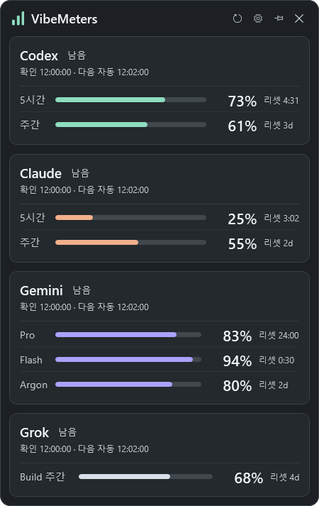
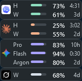
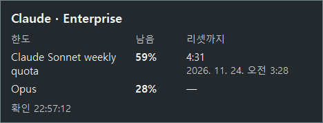

# VibeMeters

**한국어** · [English](README.en.md)

Codex, Claude, Gemini, Grok의 구독 한도가 얼마나 남았는지, 언제 다시 채워지는지 한 창에서 확인하는 Windows 앱입니다. 자주 확인하는 서비스는 작업표시줄에도 띄울 수 있습니다.

**[Windows용 ZIP 다운로드](https://github.com/Nectarine-Peach/VibeMeters/releases/latest/download/VibeMeters-win-x64.zip)** · [v1.4.15 변경 사항](docs/releases/v1.4.15.md)



그래프 오른쪽에는 선택한 기준에 따른 백분율과 리셋까지 남은 시간이 표시됩니다. 위 예시에서 Claude의 5시간 한도는 25%가 남았고 3시간 2분 뒤에 리셋됩니다. 남은 시간이 24시간 이하면 `3:02`, `24:00`처럼 시간과 분으로, 24시간을 넘으면 `2d`처럼 일 단위로 표시됩니다.

## 설치하고 계정 연결하기

1. Windows 10 또는 11의 64비트 PC에서 ZIP **전체를** 원하는 폴더에 풉니다. `runtime` 폴더는 `VibeMeters.exe`와 같은 위치에 두세요. 실행에 필요한 .NET과 Node.js는 ZIP에 포함되어 있습니다.
2. `VibeMeters.exe`를 실행한 뒤 오른쪽 위 톱니바퀴를 누릅니다. **일반 → 표시할 서비스 · 수치 기준**에서 서비스 이름 옆의 체크박스를 켜고, 서비스마다 **남은 양** 또는 **사용한 양**을 고릅니다.
3. **계정 · CLI → 계정 연결**에서 사용할 서비스에 로그인합니다. Codex와 Claude는 공식 CLI에 이미 로그인했다면 기존 인증을 사용할 수 있습니다. CLI 설치 안내가 나오면 **설치 후 로그인**을 선택하고 브라우저에서 인증을 마치세요.
4. 사용량 창에서 **F5**를 눌러 사용량을 확인합니다. 핀 아이콘을 누르면 다른 창 위에 고정됩니다.

**설정 → 계정 · CLI → CLI 설치 및 업데이트**에서 Codex CLI, Claude Code, Antigravity CLI의 설치 상태와 버전을 확인하고 **설치** 또는 **업데이트**를 한 번 누르면 작업을 시작합니다. 진행 중 같은 버튼은 **취소**로 바뀝니다. 설치와 업데이트는 로그인과 별개입니다. 회사 정책이나 기존 설치 방식 때문에 실패하면 해당 행에 원인을 표시합니다. [CLI 관리 안내](docs/cli-installation.md)

**업데이트할 때**는 알림 영역의 VibeMeters 아이콘을 오른쪽 클릭해 **종료**한 뒤, 새 ZIP 전체를 풀고 새 폴더에서 실행하세요. 설정과 기존 로그인은 다시 사용할 수 있습니다. 실행 경로가 바뀌었다면 **Windows 시작 시 실행**을 껐다 켜서 자동시작 경로를 갱신하세요.

## 작업표시줄 위젯

**설정 → 일반 → 표시할 서비스 · 수치 기준**에서 원하는 서비스의 **위젯**을 켜세요. 사용량 창에는 네 서비스를 모두 표시하면서 작업표시줄에는 Claude만 띄우는 식으로 따로 선택할 수 있습니다. 위젯은 기본 모니터의 작업표시줄 안에서 빈 공간을 사용하며, 클릭하면 사용량 창이 열립니다.

가로 작업표시줄에서는 오른쪽 알림 영역 바로 왼쪽에, 세로 작업표시줄에서는 알림 영역 쪽 끝에 배치합니다. 시작 버튼 반대편의 큰 빈 공간으로 이동하지 않으며, 공간이 부족하면 읽을 수 있는 폭을 유지하면서 일부 위젯을 숨깁니다. 전체 화면 앱과 작업표시줄 자동 숨김은 그대로 따릅니다.



위젯의 각 행은 **한도 이름 → 그래프 → 백분율 → 리셋까지 남은 시간** 순서입니다. `H`는 5시간, `W`는 주간 한도이며 개인 한도·월 추가 사용 행은 `M`으로 표시합니다. Gemini 모델은 Argon `A`, Pro `P`, Flash `F`, Flash-Lite `FL`로 줄여 씁니다.

**전체 이름과 정확한 리셋 시각**을 보려면 위젯에 마우스를 올리세요. 툴팁이 작업표시줄에서 바탕 화면 쪽으로 열립니다. 아래 예시에서 Claude Sonnet 주간 한도는 59%가 남았고, 4시간 31분 뒤에 리셋됩니다. Opus는 28%가 남았으며 서비스에서 리셋 시각을 제공하지 않아 `—`로 표시됩니다.



## 서비스별로 확인할 수 있는 한도

| 서비스 | 개인 계정 | 회사 계정 또는 기타 구독 |
| --- | --- | --- |
| Codex | 계정이 제공하는 5시간·주간 등 구독 한도 | Business 계정의 개인 한도와 리셋 시각 |
| Claude | 5시간·주간 한도, 활성화된 월 추가 사용 | Enterprise 계정에서 활성화된 월 추가 사용 비율 |
| Gemini | Antigravity가 제공하는 공유 5시간·주간 한도 및 Argon 한도 | Code Assist 계정과 프로젝트에서 제공하는 모델별 할당량 |
| Grok | 공식 Grok Build CLI가 제공하는 X 구독 사용량 | 응답에 따라 Build 전용 또는 공유 구독 한도로 표시 |

표시되는 백분율은 각 서비스가 제공하는 계정 한도 기준입니다. 정상적으로 연결됐어도 서비스가 비율을 제공하지 않으면 **연결됨 · 비율 미제공**으로 표시됩니다. 회사 계정은 조직의 SSO, 프로젝트 권한, 네트워크 정책에 따라 조회 범위가 달라집니다. [개인·회사 계정 안내](docs/account-usage.md) · [Grok Build 연결 안내](docs/grok-usage.md)

### Gemini 계정 전환

**설정 → 계정 · CLI → Gemini 계정**에서 한 번에 표시할 계정을 선택합니다.

- **기본 CLI 계정**은 기존 CLI 연결을 사용합니다.
- **Antigravity**는 설치된 공식 Antigravity CLI 1.4.7 이상에 로그인한 개인 계정의 사용량을 보여 줍니다. 사용량 창에서 **Gemini · Antigravity**로 구분할 수 있습니다.
- **Code Assist 1**, **Code Assist 2**에는 회사 계정을 각각 연결할 수 있습니다. 하나를 선택하고 **Gemini 로그인**을 눌러 인증한 다음 다른 계정도 같은 방법으로 연결하세요. 로그인 세션이 유효한 동안은 목록에서 계정만 바꾸면 됩니다.

## 창과 새로고침 설정

| 하고 싶은 일 | 방법 |
| --- | --- |
| 창을 숨기거나 다시 열기 | 닫기 또는 **Esc**로 숨깁니다. 알림 영역의 앱 아이콘을 클릭하면 다시 열립니다. |
| 앱 완전히 종료하기 | 알림 영역의 앱 아이콘을 오른쪽 클릭하고 **종료**를 선택합니다. |
| 창 위치와 크기 바꾸기 | 창을 끌어서 옮기거나 가장자리를 끌어 크기를 조절합니다. 위치와 크기는 자동으로 저장됩니다. |
| 테마와 언어 바꾸기 | **설정 → 일반**에서 다크·라이트·시스템 테마와 한국어·영어·시스템 언어를 선택합니다. |
| 남은 한도가 적을 때 알림 받기 | 설정에서 **남은 한도 20%·5% 알림**을 켭니다. |

사용량은 기본 **2분마다** 확인합니다. 설정에서 30초·1분·2분·5분·15분·수동 중 하나를 선택할 수 있습니다. 수동 모드에서도 리셋까지 남은 시간은 계속 갱신됩니다. Windows 잠금이나 절전 중에는 조회를 멈춥니다. [다른 테마와 설정 화면 보기](docs/screenshots/README.md)

## 사용량이 표시되지 않을 때

| 화면에 표시되는 상태 | 확인할 내용 |
| --- | --- |
| 로그인 또는 연결 필요 | 설정에서 해당 서비스의 공식 CLI 로그인을 완료하고 **F5**를 누르세요. Codex·Claude·Gemini·Grok은 각자 사용하는 CLI와 계정이 다릅니다. [CLI 설치와 로그인 안내](docs/cli-installation.md) |
| Claude 인증 확인 또는 재시도 | 앱이 기존 로그인으로 인증 갱신을 시도합니다. 자동 갱신에는 Claude Code 2.1.317 이상이 필요합니다. 다시 로그인하려면 **Claude 로그인**을 누르세요. [Claude Code 업데이트](https://code.claude.com/docs/en/setup#update-claude-code) |
| 요청 제한 대기 | 서비스가 허용하는 다음 조회 시각을 확인하세요. **F5**를 누르거나 앱을 다시 열어도 서버의 재시도 대기 시간을 지킵니다. |
| Claude에 이전 값이 표시됨 | 일시 오류 때 같은 계정에서 최근 30분 이내 확인한 값이 남을 수 있습니다. 다음 조회 때 인증이 바뀌었거나 리셋 시각이 지난 값은 숨깁니다. |
| Gemini 한도가 보이지 않음 | 개인 계정은 Antigravity의 로그인 상태를, 회사 계정은 선택한 Code Assist 계정의 프로젝트 권한과 ZIP의 `runtime` 폴더를 확인하세요. |

## 개인정보와 실행 환경

VibeMeters 가입 없이 각 서비스의 기존 계정으로 사용합니다. 앱 설정은 `%LOCALAPPDATA%\VibeMeters\settings.json`에 저장합니다. Codex·Claude는 로컬 CLI 인증을 사용하며, Gemini·Grok은 공식 클라이언트가 인증을 관리합니다. Claude 인증 진단 파일에는 복구 결과와 오류 분류를 기록하며 토큰이나 CLI 원문은 기록하지 않습니다. [인증과 갱신 방식](docs/account-usage.md)

배포 파일에 코드 서명이 없어 Windows에서 알 수 없는 게시자 안내를 표시할 수 있습니다. VibeMeters는 OpenAI·Anthropic·Google·xAI와 제휴하지 않은 독립 프로젝트입니다.

<details>
<summary>개발자용 빌드와 테스트</summary>

Windows x64에서 .NET 8 SDK와 Node.js 24.22.0/npm으로 빌드합니다.

```powershell
git clone https://github.com/Nectarine-Peach/VibeMeters.git
cd VibeMeters
dotnet build -c Release
dotnet run --project tests/VibeMeters.Tests.csproj -c Release
dotnet .\bin\Release\net8.0-windows\VibeMeters.dll --smoke-test
.\scripts\publish.ps1
```

UI 검사 결과와 PNG는 빌드 폴더의 `artifacts`에, 배포 폴더와 ZIP은 `dist`에 저장됩니다. 배포 스크립트는 완료 후 이전 관리 대상 패키지를 정리합니다. 별도로 보관할 빌드는 `-OutputDirectory`로 `dist` 밖의 새 경로를 지정하세요. 계정 연결 없이 예시 화면을 보려면 `VibeMeters.exe --demo`를 실행하세요. [패키징 안내](docs/packaging.md) · [검증 기록](VERIFICATION.md) · [구현 조사](RESEARCH.md) · [디자인 시안](docs/design/README.md)

</details>

오류를 제보할 때는 앱 버전, Windows 배율, 해당 서비스와 오류 문구를 알려 주세요. 인증 파일이나 액세스 토큰은 첨부하지 마세요. [버그 제보](https://github.com/Nectarine-Peach/VibeMeters/issues)
