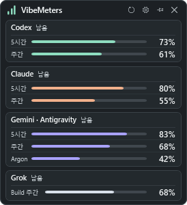
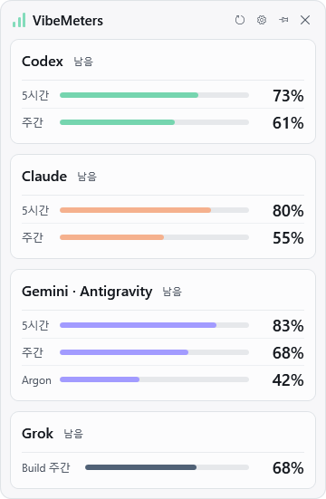
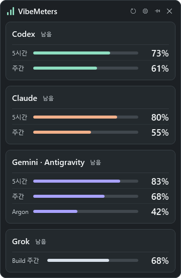
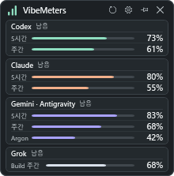
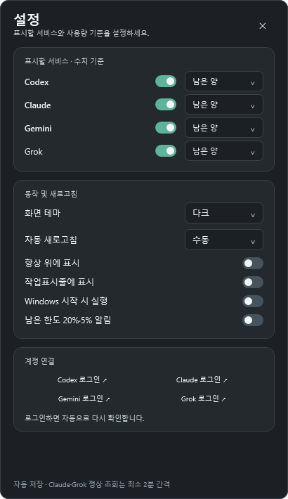

# VibeMeters

**한국어** · [English](README.en.md)

Codex·Claude·Gemini·Grok의 남은 한도와 사용량을 작은 Windows 창에서 확인하세요.

**Windows 10/11 x64 · 트레이 상주 · 항상 위 · 다크/라이트 테마**

**Gemini 개인 계정(Antigravity)과 Grok Build 구독 한도도 앱 안에서 표시합니다.**

[Windows용 ZIP 다운로드](https://github.com/Nectarine-Peach/VibeMeters/releases/latest/download/VibeMeters-win-x64.zip) · [릴리스 노트](https://github.com/Nectarine-Peach/VibeMeters/releases/latest)



네 서비스의 합성 데모를 실제 WPF 화면으로 렌더링했습니다. Gemini는 개인 Antigravity 한도, Grok은 Build 전용 한도 예시이며 실계정 수치가 아닙니다.

## 지원 계정과 표시 항목

개인 구독 한도와 함께 **Codex Business 개인 한도 · Claude Enterprise 월 추가 사용**을 표시합니다.

| 서비스·계정 | 표시하는 사용량 |
| --- | --- |
| **Codex 개인 구독** | 계정에서 제공한 5시간·주간 등 구독 한도 |
| **Codex Business** | **개인** 한도의 남은/사용 비율과 제공된 초기화 시각 |
| **Claude 개인 구독** | 5시간·주간 구독 한도와 활성화된 월 추가 사용 |
| **Claude Enterprise** | **월추가** 사용 비율. 개인 구독의 5시간·주간 한도와 구분 |
| **Gemini 개인 계정 / Antigravity** | Gemini 공유 5시간·주간 및 제공되는 Argon 한도. Gemini 웹·앱 한도와 구분 |
| **Gemini 회사 계정 / Code Assist** | 지원되는 계정·프로젝트가 반환한 모델별 할당량 |
| **Grok Build / X 구독** | 공식 Build CLI가 제공한 Build 전용 또는 공유 구독 사용 비율·초기화 정보 |

Codex Business는 `spend_control.individual_limit`, Claude Enterprise는 활성화된 `extra_usage.utilization` 응답을 사용합니다. 비율이 없는 지원 응답에는 **연결됨 · 비율 미제공**을 표시하며 수치를 추정하지 않습니다. 회사의 서비스 권한·SSO·네트워크 정책에 따라 조회나 로그인이 제한될 수 있으며, 모든 회사 계정 구성을 보장하지 않습니다. v1.4.4에서 실제 계정 재로그인·SSO 승인은 별도 검증하지 않았습니다. [개인·회사 계정 상세 안내](docs/account-usage.md) · [검증 범위](VERIFICATION.md).

## 빠른 시작

1. **ZIP 전체**를 압축 해제하고 `VibeMeters.exe`를 실행하세요. Gemini에 필요한 `runtime` 폴더를 EXE와 함께 보관하세요.
2. 상단 톱니바퀴로 설정을 열고 표시할 서비스와 계정을 연결하세요.
3. 창 크기를 조절하고 핀 아이콘으로 항상 위에 고정하세요.

설치 프로그램 없이 실행합니다. 소스에서 직접 만들려면 아래 **소스에서 빌드·검증**을 펼치세요.

## 상세 가이드

<details>
<summary>계정 연결</summary>

| 서비스 | 연결 방법 | 표시 정보 |
| --- | --- | --- |
| **Codex** | 설정의 **Codex 로그인**. CLI가 없으면 공식 설치를 선택한 뒤 로그인 | 계정에서 제공한 구독 한도·Business 개인 한도 |
| **Claude** | 설정의 **Claude 로그인**. CLI가 없으면 공식 설치를 선택한 뒤 로그인 | 5시간·주간 구독 한도·Enterprise를 포함한 활성화된 월 추가 사용 |
| **Gemini** | 개인 계정은 설치된 Antigravity CLI 1.4.7 이상에서 로그인, 회사 계정은 기존 Code Assist 인증 | Antigravity의 Gemini 공유 한도 또는 회사 Code Assist 할당량·초기화 정보 |
| **Grok** | 공식 Grok Build CLI 설치 후 설정의 **Grok 로그인**, 또는 `grok login --oauth` | 공식 CLI의 구독 비율과 초기화 시각. Build 전용·공유 범위 구분, API 비용·추가 금액 제외 |

Codex·Claude는 기존 인증 파일이 있으면 CLI 없이 사용량을 조회합니다. 로그인 버튼을 눌렀을 때 CLI가 없으면 **설치 후 로그인** 또는 취소를 선택할 수 있습니다. 선택한 경우에만 공식 설치 프로그램을 내려받아 현재 사용자 계정에 설치하며 진행·오류·재시도를 안내합니다. 설치 뒤 CLI를 다시 찾고 기존 로그인 흐름으로 연결합니다. 설치에는 인터넷이 필요하며 관리자 권한을 요청하지 않습니다. [CLI 설치 범위](docs/cli-installation.md).

Codex·Claude 로그인은 설치된 공식 CLI를 백그라운드에서 실행합니다. 터미널 창 없이 열린 브라우저에서 인증을 완료하세요. 앱은 로그인 결과를 확인한 뒤 사용량을 다시 조회하며, 5분 안에 완료되지 않으면 대기를 종료합니다. 웹사이트나 데스크톱 앱 로그인만으로는 필요한 CLI 인증 파일이 없을 수 있습니다. 인증 파일 변경도 자동으로 감지합니다. Gemini 개인 경로의 로그인 버튼은 공식 Antigravity 창을 열며 완료 후 새로고침합니다.

Gemini는 기본적으로 꺼져 있습니다. 개인 계정은 공식 Antigravity CLI의 `/usage`를 조회하고 카드에 **Gemini · Antigravity**로 출처를 표시합니다. Gemini 웹·앱 한도와 별개이며, Pro/Flash 공유 한도를 모델별로 나누지 않습니다. 회사 계정은 지원되는 Code Assist 프로젝트를 사용합니다. 사용량은 **VibeMeters 안에서** 표시하며 일반 조회는 터미널·브라우저나 모델 생성 요청을 열지 않습니다. [계정별 안내](docs/account-usage.md).

Grok도 기본적으로 꺼져 있습니다. 공식 Grok Build CLI의 기존 인증을 사용하므로 브라우저 확장은 필요하지 않습니다. 일반 조회는 모델·세션·로그인을 실행하지 않으며 앱이 인증 파일 내용을 읽거나 토큰을 갱신하지 않습니다. 응답이 Build 전용이면 **Build**, 공유 구독이면 **공유**로 표시합니다. CLI가 제공하지 않는 Grok Bot 한도는 만들지 않습니다. [Grok 연결 범위](docs/grok-usage.md).

표시값은 계정 한도의 비율입니다. API 키 결제액·토큰 비용·정확한 남은 질문 횟수를 의미하지 않습니다. 서버가 제공하지 않는 값은 추정하지 않습니다. 회사 계정의 개인 한도·월 추가 사용은 구독의 5시간·주간 한도와 구분하며, 비율을 제공하지 않는 정상 응답은 **연결됨 · 비율 미제공**으로 표시합니다. [개인·회사 계정 안내](docs/account-usage.md)를 참고하세요. VibeMeters 자체 계정은 필요하지 않습니다.

</details>

<details>
<summary>설정과 기본 조작</summary>

| 조작 | 방법 |
| --- | --- |
| 새로고침 | 상단 새로고침 아이콘, **F5**, 트레이 메뉴 |
| 서비스·테마·표시 기준 선택 | 상단 톱니바퀴 → 설정 |
| 항상 위에 표시 | 상단 핀 또는 트레이 메뉴 |
| 트레이로 숨기기 | 닫기 또는 **Esc** |
| 창 다시 열기 | 트레이 아이콘 클릭 또는 앱 다시 실행 |
| 앱 종료 | 트레이 아이콘 우클릭 → **종료** |

- **서비스 선택:** Codex·Claude·Gemini·Grok 중 원하는 조합만 표시합니다. 최소 한 서비스는 유지합니다. Gemini와 Grok은 기본적으로 꺼져 있습니다.
- **표시 기준:** 서비스별로 남은 양 또는 사용한 양을 선택하며 창과 트레이 막대에 함께 적용합니다.
- **테마:** 다크·라이트·시스템 중 선택합니다. 메인 창·설정·메뉴·툴팁에 적용합니다.
- **창 크기:** 표준·미니 창에서 같은 카드 구성과 세로 한도 행을 유지합니다. 최소 220 × 140 논리 픽셀부터 조절하며 한도가 많으면 최소 높이가 늘어납니다. 넓은 창에서는 카드를 가로로 배치합니다. 메인 창에는 스크롤이 없습니다.
- **동작:** Windows 자동시작, 작업표시줄 표시, 남은 한도 20%·5% 알림을 선택할 수 있습니다. 설정은 즉시 저장합니다.

창 이동·크기 변경은 자동 저장하며, 닫기·Windows 종료·절전 때 마지막 상태를 저장합니다. Windows 자동시작은 저장된 창 크기·위치와 표시 또는 트레이 상태를 복원합니다. 업데이트가 창을 기본 크기로 되돌리지 않으며, 이전 모니터가 없으면 보이는 화면으로 옮깁니다.

작업표시줄은 일반 앱 아이콘과 최소화 기능을 제공합니다. 충분히 넓은 창에서는 최소화 버튼이 나타납니다. 한도 위젯이나 진행률 막대는 표시하지 않습니다.

문서는 한국어·영어로 제공합니다. 현재 앱 화면 문구는 한국어이며 앱 내부 영어 전환 기능은 포함되어 있지 않습니다.

</details>

<details>
<summary>더 많은 화면</summary>

| 표준 다크 | 표준 라이트 |
| :---: | :---: |
|  |  |

| 네 서비스 함께 표시 | 네 서비스 최소 폭 |
| :---: | :---: |
|  |  |



2026-10-26의 v1.4.5 WPF 컨트롤을 합성 데이터로 렌더링한 이미지입니다. 표준은 360×551, 미니는 274×300, 최소 폭은 220×223 논리 픽셀로 모든 행을 유지합니다. 실제 계정·인증·사용자 설정에 접근하지 않았습니다. OS 창 테두리·트레이 픽셀을 포함한 데스크톱 캡처나 회귀 검증 결과는 아닙니다. [캡처 방식과 범위](docs/screenshots/README.md).

</details>

<details>
<summary>조회 간격과 문제 해결</summary>

새로고침은 **30초·1분·2분·5분·15분·수동** 중 선택하며 기본은 2분입니다. Windows 잠금·절전 중에는 조회를 멈춥니다. 실시간 서버 스트리밍이 아닌 주기적인 조회이므로 서비스별 캐시와 재시도 대기에 따라 실제 간격은 더 길 수 있습니다.

한도 행이나 상태 표시에 마우스를 올리면 초기화 시각과 연결 상태를 확인할 수 있습니다.

| 상황 | 해결 방법 |
| --- | --- |
| Codex·Claude가 연결되지 않음 | 공식 CLI 또는 설정에서 로그인한 뒤 새로고침하세요. |
| Claude가 조회 일시 제한으로 표시됨 | 툴팁의 재시도 시각까지 기다리세요. HTTP 429는 **사용량 조회 요청**의 제한이며 구독 한도 소진과 다릅니다. |
| 오류 후 이전 비율이 남아 있음 | 마지막 성공 조회값입니다. 상태 툴팁에서 최신 여부를 확인하세요. |
| Gemini 사용량이 나오지 않음 | 개인 계정은 Antigravity CLI 1.4.7 이상과 로그인을 확인하세요. 회사 계정은 프로젝트 권한과 동봉 runtime을 확인하세요. [계정별 안내](docs/account-usage.md). |
| 앱 이동 후 자동시작이 안 됨 | 설정에서 Windows 시작 시 실행을 껐다가 다시 켜서 경로를 갱신하세요. |

Claude의 성공 조회는 **최소 2분** 간격으로 캐시합니다. 429 응답 뒤에는 **5 → 10 → 20 → 30 → 60분** 대기하며 서버가 더 긴 시간을 요청하면 따릅니다. 수동 새로고침도 대기를 우회하지 않습니다. Gemini 회사 조회는 **5분** 캐시하며 Antigravity 조회는 매 새로고침마다 현재 계정 값을 확인합니다. Gemini 조회 제한 뒤에는 **10분** 기다립니다. Grok 정상 조회는 **2분** 캐시하고 요청 제한 뒤 **10분** 기다립니다. 이는 앱의 보호 정책이며 공식적인 요청 허용 횟수나 조회 제한 방지를 보장하지 않습니다.

</details>

<details>
<summary>개인정보와 호환성</summary>

- **인증:** Codex는 `%USERPROFILE%\.codex\auth.json`(`CODEX_HOME` 지원), Claude는 `%USERPROFILE%\.claude\.credentials.json`(`CLAUDE_CONFIG_DIR` 지원)에서 읽습니다. 앱은 이 두 서비스의 토큰을 별도 저장하거나 갱신하지 않습니다. Windows 자격 증명 관리자에만 저장된 로그인은 현재 지원하지 않습니다.
- **Gemini:** 회사 경로는 동봉한 공식 `@google/gemini-cli-core` **0.65.0**, 개인 경로는 설치된 공식 Antigravity CLI를 사용합니다. 각 공식 클라이언트가 인증을 관리하며 원본 토큰을 .NET 앱의 설정이나 사용량 출력에 전달하지 않습니다.
- **Grok:** 설치된 공식 Grok Build CLI가 인증을 관리합니다. 앱은 인증 파일의 수정 시각만 감시하며 인증 파일 내용·토큰을 읽거나 저장하지 않습니다. Grok CLI와 브라우저 확장을 배포본에 동봉하거나 자동 설치하지 않습니다.
- **로컬 저장:** 앱 설정은 `%LOCALAPPDATA%\VibeMeters\settings.json`에 저장합니다. 자동시작은 현재 사용자의 Windows Run 레지스트리를 사용합니다. 소스와 배포본에는 인증 정보를 포함하지 않습니다.
- **연동:** Codex·Claude는 계정용 엔드포인트를, Gemini는 Code Assist 코어 또는 공식 Antigravity 사용량 명령을, Grok은 공식 Build CLI의 ACP billing 계약을 사용합니다. 서비스 정책이나 구현 변경으로 연동이 제한될 수 있습니다.
- **실행 환경:** Windows 10/11 x64용 네이티브 WPF/.NET 8 앱입니다. 배포본에 .NET이 포함되며 내장 브라우저나 지속적인 애니메이션이 없습니다. Gemini 회사 경로는 숨겨진 Node 프로세스를, 개인 경로와 Grok은 설치된 공식 CLI의 짧은 프로세스를 사용합니다. 특정 메모리·CPU 사용량 수치는 보장하지 않습니다.

배포본은 코드 서명이 없어 Windows에서 알 수 없는 게시자 안내가 나올 수 있습니다. VibeMeters는 OpenAI·Anthropic·Google·xAI와 제휴하지 않은 독립 프로젝트입니다.

</details>

<details>
<summary>소스에서 빌드·검증</summary>

Windows x64, **.NET 8 SDK**, **Node.js 24.22.0/npm**이 필요합니다. 배포 스크립트는 잠금 파일로 빌드 의존성을 복원하고 Gemini 공식 코어의 인증·할당량 브리지를 번들링합니다. 배포본에는 `node.exe`와 번들·라이선스만 포함하며 `node_modules`는 포함하지 않습니다. 빌드용 Node 버전은 `runtime/gemini-quota/package.json`에 고정합니다.

```powershell
git clone https://github.com/Nectarine-Peach/VibeMeters.git
cd VibeMeters
dotnet build -c Release
.\scripts\publish.ps1
.\dist\VibeMeters-portable-win-x64\VibeMeters.exe
```

산출물은 `dist/VibeMeters-portable-win-x64/`와 같은 이름의 ZIP입니다. 기존 산출물은 덮어쓰지 않으며 다시 빌드할 때는 `-OutputDirectory`로 새 경로를 지정하세요. `-Node`로 고정 버전 Node의 경로를 선택할 수 있습니다. runtime 폴더를 함께 배포해야 하며 사용 PC에 .NET·Node·npm 설치는 필요하지 않습니다. 설정과 CLI 인증 저장 위치는 기존과 같습니다. 패키징 경계와 오프라인 검사 방법은 [패키징 안내](docs/packaging.md)를 참고하세요. 배포본과 변경 사항은 [릴리스 페이지](https://github.com/Nectarine-Peach/VibeMeters/releases)에서 확인하세요.

격리된 제공자·파서·설정 회귀 테스트:

```powershell
dotnet run --project tests/VibeMeters.Tests.csproj -c Release
```

데모 데이터로 실행 창을 검사하고 렌더링 캡처를 저장하려면:

```powershell
dotnet build -c Release
dotnet .\bin\Release\net8.0-windows\VibeMeters.dll --smoke-test
```

결과와 PNG는 빌드 폴더의 `artifacts/`에 저장됩니다. 버전별 결과와 제약은 [검증 기록](VERIFICATION.md)을 참고하세요. `VibeMeters.exe --demo`는 계정에 접근하지 않는 예시 데이터 미리보기입니다.

버그 제보에는 앱 버전·Windows 배율·창 크기·서비스·오류 문구를 알려 주세요. 인증 파일이나 액세스 토큰은 첨부하지 마세요.

</details>

[버그 제보](https://github.com/Nectarine-Peach/VibeMeters/issues) · [구현 조사](RESEARCH.md) · [검증 기록](VERIFICATION.md) · [디자인 시안](docs/design/README.md)
