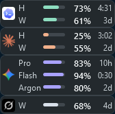

# VibeMeters v1.4.12

Windows 작업표시줄에서 서비스별 사용량과 다음 리셋까지 남은 시간을 바로 볼 수 있습니다.

- **설정 → 표시할 서비스 · 수치 기준**에서 Codex·Claude·Gemini·Grok의 본체 표시와 위젯 표시를 각각 선택하세요. 위젯은 작업표시줄의 빈 공간에 표시되며, 클릭하면 본체가 열립니다.
- 각 한도는 이름, 그래프, 백분율, 리셋 시간을 한 줄에 표시합니다. 리셋까지 24시간이 넘으면 `1d`, `2d`처럼 일 단위로, 24시간 이하면 `24:00`, `10:00`, `4:31`처럼 시간과 분으로 표시합니다. 작업표시줄 위젯에서는 Gemini의 Argon·Pro·Flash·Flash-Lite는 각각 `A`·`P`·`F`·`FL`로 표시하며, 전체 이름은 툴팁에서 확인할 수 있습니다.
- **Gemini**는 Antigravity와 두 개의 독립적인 Code Assist 로그인 프로필을 지원합니다. **Claude**는 로그인 버튼을 누르면 사용량 조회를 기다리지 않고 공식 CLI 인증을 시작합니다. **Codex**는 조회 중 작업공간이 바뀌면 이전 작업공간의 결과를 버립니다.

기존 앱을 트레이 메뉴에서 종료하고 ZIP 전체를 새 폴더에 푼 뒤 `VibeMeters.exe`를 실행하세요. `runtime` 폴더는 실행 파일 옆에 두세요. 실행 경로가 바뀌었고 자동시작을 사용한다면 설정에서 **Windows 시작 시 실행**을 껐다 켜세요. [Windows x64 ZIP 다운로드](https://github.com/Nectarine-Peach/VibeMeters/releases/download/v1.4.12/VibeMeters-win-x64.zip)

English release notes

- Choose dashboard and widget visibility separately for Codex, Claude, Gemini and Grok in **Settings → Services · Display basis**. Widgets use free space inside the Windows taskbar. Click a widget to open the dashboard.
- Each quota displays its label, graph, percentage and live reset countdown on one line. Above 24 hours the countdown shows whole days, such as `1d` or `2d`. At 24 hours or less it shows hours and minutes, such as `24:00`, `10:00` or `4:31`. The Gemini widget abbreviates Argon, Pro, Flash and Flash-Lite as `A`, `P`, `F` and `FL`. Hover for full names.
- Gemini supports Antigravity and two independent Code Assist sign-in profiles. Claude starts the official CLI sign-in immediately when you click the login button. Codex discards a quota result if the workspace changes during the lookup.

Exit VibeMeters from the tray menu, extract the entire ZIP into a new folder and run `VibeMeters.exe` with the `runtime` folder beside it. If you moved the executable and use automatic startup, toggle **Start with Windows** off and back on. [Download the Windows x64 ZIP](https://github.com/Nectarine-Peach/VibeMeters/releases/download/v1.4.12/VibeMeters-win-x64.zip)

