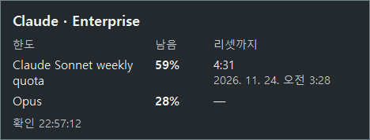
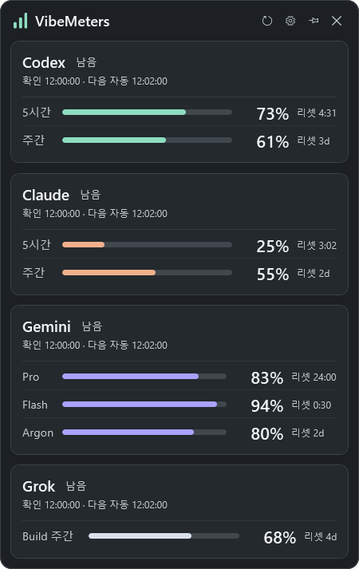
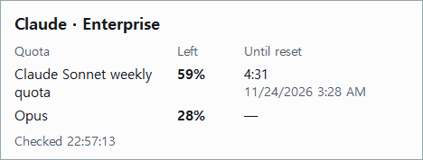
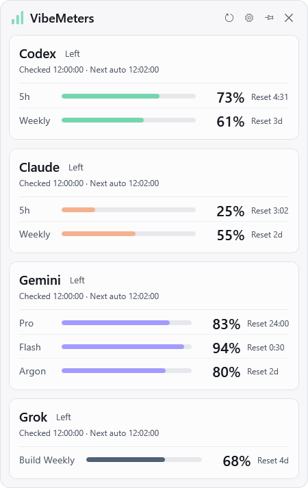

# VibeMeters v1.4.13

Windows 작업표시줄을 클릭할 때 위젯이 잠시 사라지던 문제를 수정했습니다.

## 위젯 툴팁

위젯에 마우스를 올리면 각 한도의 전체 이름, 남은 비율 또는 사용한 비율, 리셋까지 남은 시간을 볼 수 있습니다. 서비스가 제공한 리셋 시각은 현지 시간으로 표시합니다. 툴팁은 다른 위젯을 가리지 않도록 작업표시줄 바깥쪽으로 열립니다.

## 사용량 창

Claude의 `5시간`·`주간`과 Gemini의 `Pro`·`Flash`·`Argon`을 전체 이름으로 표시합니다. 작업표시줄 위젯에서는 한 줄에 표시할 수 있도록 짧은 이름을 사용합니다.

## 업데이트

트레이 메뉴에서 기존 앱을 종료하고 ZIP 전체를 새 폴더에 푼 뒤 `VibeMeters.exe`를 실행하세요. `runtime` 폴더는 실행 파일과 같은 위치에 두세요. 자동 시작을 사용하면서 실행 파일의 위치를 옮겼다면 설정에서 **Windows 시작 시 실행**을 껐다 켜세요. [Windows x64 ZIP 다운로드](https://github.com/Nectarine-Peach/VibeMeters/releases/download/v1.4.13/VibeMeters-win-x64.zip)

English release notes

Fixed a flicker that briefly hid widgets when you clicked the Windows taskbar.

### Widget tooltips

Hover over a widget to see each quota’s full name, remaining or used percentage, and time until reset. When the service supplies a reset time, the tooltip also shows the local date and time. It opens toward the desktop to keep the other widgets visible.

### Dashboard

The dashboard shows Claude’s `5h` and `Weekly` limits and the full Gemini model names `Pro`, `Flash` and `Argon`. Taskbar widgets use compact labels.

### Update

Exit VibeMeters from the tray menu, extract the entire ZIP into a new folder, and run `VibeMeters.exe` with the `runtime` folder beside it. If you use automatic startup and moved the executable, turn **Start with Windows** off and on again. [Download the Windows x64 ZIP](https://github.com/Nectarine-Peach/VibeMeters/releases/download/v1.4.13/VibeMeters-win-x64.zip)

