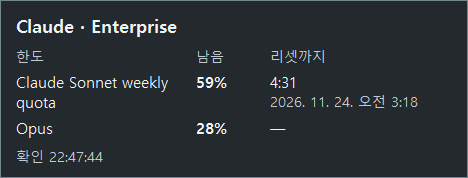
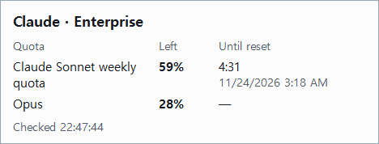

# VibeMeters v1.4.13

- **작업표시줄 포커스** — Windows 작업표시줄을 클릭할 때 위젯이 잠시 가려졌다가 다시 나타나는 현상을 수정했습니다. 오른쪽 작업표시줄에서 열 차례 포커스를 전환해 네 위젯이 계속 보이는 것을 확인했습니다.
- **위젯 툴팁** — 위젯에 마우스를 올리면 한도 전체 이름, 남은 양 또는 사용량, 리셋까지 남은 시간을 한 행에서 확인할 수 있습니다. 서비스가 리셋 시각을 제공하면 로컬 날짜와 시각도 표시합니다. 툴팁은 작업표시줄에서 바탕화면 쪽으로 열립니다.
- **본체 그래프** — 한도 이름을 `5시간`, `Argon`처럼 읽을 수 있게 표시합니다. 작은 작업표시줄 위젯에서는 `H`, `A` 같은 약칭을 사용합니다.

기존 앱을 트레이 메뉴에서 종료하고 ZIP 전체를 새 폴더에 푼 뒤 `VibeMeters.exe`를 실행하세요. `runtime` 폴더는 실행 파일 옆에 두세요. 자동시작을 사용하고 실행 경로가 바뀌었다면 **Windows 시작 시 실행**을 껐다 켜세요. [Windows x64 ZIP 다운로드](https://github.com/Nectarine-Peach/VibeMeters/releases/download/v1.4.13/VibeMeters-win-x64.zip)

English release notes

- **Taskbar focus** — Fixed a flicker when Windows brought the taskbar in front of the widgets. All four widgets stayed visible across ten focus cycles on a right-hand taskbar.
- **Widget tooltips** — Hover over a widget to see full quota names, remaining or used percentages and reset countdowns in aligned rows. A local date and time appear when the service provides a reset deadline. The tooltip opens toward the desktop, clear of neighboring widgets.
- **Dashboard labels** — The dashboard uses readable quota names such as Argon. Compact labels such as `H` and `A` remain on the taskbar widgets.

Exit VibeMeters from the tray menu, extract the entire ZIP into a new folder and run `VibeMeters.exe` with the `runtime` folder beside it. If you moved the executable and use automatic startup, toggle **Start with Windows** off and back on. [Download the Windows x64 ZIP](https://github.com/Nectarine-Peach/VibeMeters/releases/download/v1.4.13/VibeMeters-win-x64.zip)

