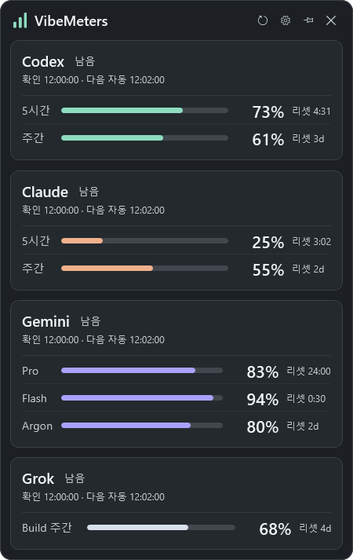
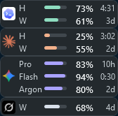
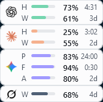
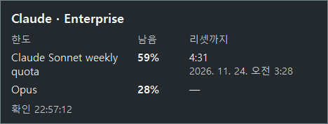
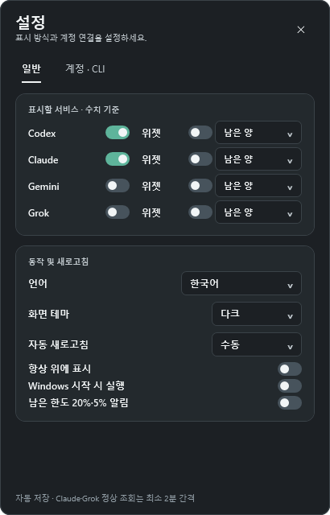
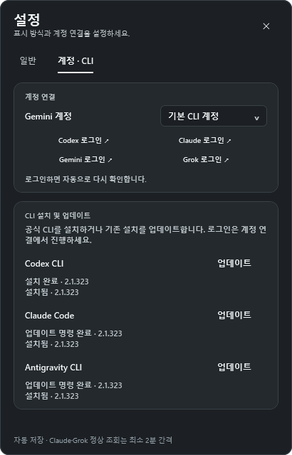

# VibeMeters 화면 안내

다음 화면은 예시 계정과 합성 상태를 보여 줍니다. 사용량 창과 툴팁은 v1.4.13, 두 탭으로 나뉜 설정은 v1.4.15에서 캡처했습니다.

## 사용량 창

서비스별로 사용량 막대, 남은 비율, 리셋까지의 시간을 확인할 수 있습니다. 아래 Claude 계정에는 5시간 한도와 주간 한도가 있고, Gemini 계정에는 Pro·Flash·Argon 한도가 있습니다.

다른 언어와 테마로 보기 · [한국어 라이트](v1.4.13/dashboard-quota-names-ko-light.png) · [English dark](v1.4.13/dashboard-quota-names-en-dark.png) · [English light](v1.4.13/dashboard-quota-names-en-light.png)

## 작업표시줄 위젯

작업표시줄에서는 서비스 아이콘 옆에 한도별로 한 줄씩 표시합니다. 아래 Claude 위젯의 `H`는 5시간 한도, `W`는 주간 한도입니다. 두 이미지는 실제 Windows 작업표시줄에서 위젯 영역만 캡처한 것입니다.

| 다크 | 라이트 |
| --- | --- |
|  |  |

## 위젯 툴팁

위젯에 마우스를 올리면 전체 한도 이름과 리셋 예정 시각을 확인할 수 있습니다. 아래 예시에서 Sonnet 주간 한도는 59%가 남았고 4시간 31분 뒤 리셋됩니다. Opus 행의 대시(`—`)는 서비스가 리셋 시각을 제공하지 않았다는 뜻입니다.

[같은 툴팁을 영어 라이트 테마로 보기](v1.4.13/widget-tooltip-light-en.png)

## 표시 설정

**설정 → 일반**에서 사용량 창에 표시할 서비스와 작업표시줄 위젯을 각각 선택하고, 언어·테마·새로고침·알림을 바꿉니다.

다른 언어와 테마로 보기 · [한국어 라이트](v1.4.15/settings-general-light-ko.png) · [English dark](v1.4.15/settings-general-dark-en.png) · [English light](v1.4.15/settings-general-light-en.png)

## 계정 연결과 CLI 관리

**설정 → 계정 · CLI**에서 계정을 연결하고 Codex CLI·Claude Code·Antigravity CLI를 설치하거나 업데이트합니다. 기본 크기에서는 두 탭 모두 스크롤 없이 표시하며, 창을 줄이거나 오류 안내가 길어지면 해당 탭 안에서만 스크롤합니다.

다른 언어와 테마로 보기 · [한국어 라이트](v1.4.15/settings-accounts-light-ko.png) · [English dark](v1.4.15/settings-accounts-dark-en.png) · [English light](v1.4.15/settings-accounts-light-en.png)

설정 8개 이미지는 실제 WPF 컨트롤을 **410×640 DIP / 96 DPI**로 렌더링한 합성 예시입니다. CLI 버전과 설치·업데이트 완료 문구는 검증용 값이며 실제 설치 상태를 나타내지 않습니다. 실제 CLI 설치·로그인·사용자 설정 쓰기는 실행하지 않았습니다. [캡처 정보와 SHA256](v1.4.15/capture.json) · [검증 범위](../../VERIFICATION.md)

## 이전 버전 캡처 기록

v1.4.12부터 v1.4.5까지의 예시 화면과 검증 기록

### v1.4.12

`current/`의 사용량 창과 설정 이미지는 v1.4.12 Release 빌드에서 120 DPI로 캡처했습니다. 인증 재시도와 요청 제한 화면은 격리된 UI 테스트의 합성 데이터입니다. [한국어 사용량 창](current/window-four-services-grok-dark.png) · [영문 인증 재시도](current/window-auth-retry-en.png) · [영문 요청 제한](current/window-refresh-wait-en.png)

### v1.4.11 배포 준비 캡처 · 2026-11-08

[`provider-reliability/`](provider-reliability/)의 이미지는 `dc28f3f`를 기반으로 영문 화면 캡처를 추가한 v1.4.11 Release 빌드에서 `--smoke-test`로 생성했습니다. WPF가 실제로 표시한 클라이언트 영역을 120 DPI에서 렌더링했으며, 화면별 글자와 한도 행을 확인했습니다.

| 이미지 | 논리 크기 | 표시 내용 |
| --- | --- | --- |
| `window-four-services-grok-dark.png`, `window-four-services-grok-en-dark.png` | 360×510.4 | 한국어 및 영문 네 서비스 개요 |
| `window-four-services-grok-minimum-dark.png` | 220×239.2 | 여섯 한도 행을 표시한 최소 폭 창 |
| `window-standard-dark.png`, `window-standard-light.png` | 360×267.2 | 한국어 표준 크기의 Codex와 Claude, 다크 및 라이트 테마 |
| `settings-dark.png`, `settings-en-dark.png` | 410.4×750.4 | 한국어 및 영문 설정 |
| `window-refresh-schedule-ko.png` | 220×140 | Claude의 마지막 확인 시각과 다음 자동 조회 시각 |
| `window-refresh-wait-en.png`, `window-auth-retry-en.png` | 220×140 | Claude의 이전 값과 조회 제한 대기, 인증 갱신 대기 |

사용량과 상태는 모두 합성 데이터입니다. 네 서비스 개요에는 Codex 주간 61%, Claude 5시간 100%·주간 55%, Gemini Pro 83%·Flash 94%, Grok Build 주간 68%가 표시됩니다. 스모크 검사는 별도 인스턴스와 메모리 설정을 사용합니다. 검증 범위는 WPF 클라이언트이며 실제 계정, 작업표시줄 및 트레이는 범위 밖입니다. [캡처별 크기와 SHA-256](provider-reliability/capture.json) · [WPF 스모크 검사 304개 통과 기록](provider-reliability/smoke-test.txt)

### 영문 현지화 이미지 · v1.4.7 · 2026-10-26

`window-standard-en-dark.png`, `window-standard-en-light.png`, `window-mini-en.png`, `settings-en.png`, `window-cached-en.png`, `cli-install-en.png`, `cli-install-progress-en.png`는 실제 v1.4.7 WPF 컨트롤의 합성 렌더입니다. 영문 화면과 설치 안내/진행 문구 예시를 직접 열어 가독성을 확인했습니다. 설치 이미지는 대화상자 클라이언트 콘텐츠이며 실제 설치를 실행한 결과가 아닙니다.

캡처 전용 하네스에서 한국어→English→한국어→English를 선택하고 캐시된 사용량의 레이블·요청 제한 툴팁·설치 상태가 원문으로 복원되는 것을 확인했습니다. 일반 레이블 폭도 42→52→42→52로 복원됐고 제공자 원문 한도 이름은 변하지 않았습니다. [전환·캡처 기록](localization-capture.json).

전체 회귀/UI 스모크를 실행하지 않았으며 실제 제공자 조회·설치·로그인·사용자 설정 쓰기 없이 메모리 설정과 합성 상태만 사용했습니다. 아래 한국어 v1.4.5 이미지 기록은 당시의 별도 캡처입니다.

### 한국어 README 이전 이미지 · 2026-10-26

2026-10-26에 README에 사용한 대표·표준·라이트·최소 폭·설정 이미지는 v1.4.5 커밋 `a52ee12e580a795a8cf623326634276a4c5b6192`의 실제 WPF 컨트롤을 사용한 **합성 데모 렌더**입니다. `Gemini · Antigravity`와 `Grok / Build 주간`의 출처·범위를 표시합니다. 모든 이미지를 실제로 열어 가독성·잘림·표시 범위를 확인했습니다.

| 이미지 | 논리 크기 |
| --- | --- |
| `window-standard-dark.png`, `window-standard-light.png` | 360×551 |
| `window-mini-dark.png`, `window-mini-light.png` | 274×300 |
| `window-minimum-dark.png` | 220×223 |
| `window-wide-dark.png` | 1040×280 |
| `settings-dark.png` | 410×710 |

96 DPI에서 기존 `VisualVerification.Capture`의 `RenderTargetBitmap` 경로를 재사용했습니다. 네 서비스 모두 표시했으며, 좁은 창은 한도 행을 숨기는 대신 높이가 늘어납니다. [파일별 캡처 정보](capture-2026-10-26.json).

데이터는 Codex 남음 73%/61%, Claude 80%/55%, 개인 Gemini Antigravity 5시간 83%·주간 68%·Argon 42%, Grok Build 주간 68%로 지정한 예시입니다. 실제 계정 비율이나 서버 상태를 나타내지 않습니다. Gemini는 웹·앱 한도가 아니며 Grok은 Build 전용 예시입니다. 공유 구독 여부는 실제 CLI 응답에 따릅니다.

현재 게시 DLL을 참조하는 임시 캡처 전용 STA 하네스에서 `MainWindow`와 `SettingsWindow`만 생성했습니다. 기본 WPF Application을 사용해 VibeMeters 앱 시작, 제공자 생성, 인증 감시, 자동 조회, 사용자 설정 저장을 실행하지 않았습니다. 현재 사용 중인 앱·인증·설정을 교체하거나 변경하지 않았습니다. 하네스는 `dist/readme-capture-20261026/`에 있으며 앱 코드는 수정하지 않았습니다.

이미지는 표시된 WPF 클라이언트 영역을 렌더링한 것으로 OS 합성 테두리·작업표시줄·트레이 픽셀이나 실제 마우스 입력을 검증하지 않습니다. 전체 회귀·UI 스모크·실계정 조회·로그인도 실행하지 않았습니다. 기존 `verification.txt`와 캐시/로그인 오류 예시 이미지는 이전 스모크 기록으로, 이번 캡처 생성의 통과 기록이 아닙니다.

